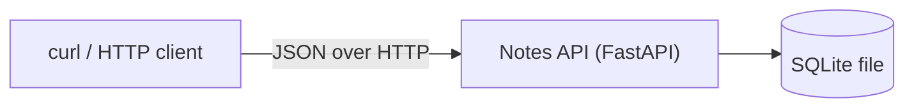

# ROOT: specx-example

The root spec. Everything here applies to every spec in this tree. The format is in [_templates/spec.md](_templates/spec.md); the rules are in [RULES.md](RULES.md).

## 1. Overview

**Purpose:** A personal notes REST API that one person runs themselves.

**Target users:** A single owner; there are no accounts.

**In scope:** Notes with a title and a body, which the owner can create, read, update, delete, and list through a JSON API.

**Out of scope:** A web or mobile UI.

## 2. Context chain

None (root).

## 3. Current state

None: new work. The repository holds only `README.md`.

## 4. Requirements

| ID | Type | Requirement | Source |
|---|---|---|---|

## 5. Acceptance criteria

None yet.

## 6. Design

Project-wide design that every spec inherits.

### 6.1 Architecture

One FastAPI service stores notes in a single SQLite file. The owner calls it over HTTP with `curl` or any HTTP client. Hosting is open (ROOT-D4).

### 6.2 Technology

| Need | Choice | Version | Decision |
|---|---|---|---|
| Language | Python | 3.14 | ROOT-D6 |
| Web framework | FastAPI | 0.162.2 | ROOT-D1 |
| Data validation | Pydantic (installed with FastAPI) | 2.14.3 | ROOT-D1 |
| ASGI server | uvicorn | 0.54.0 | ROOT-D1 |
| Database | SQLite, through the Python standard library module `sqlite3` | the SQLite of Python 3.14 | ROOT-D2, ROOT-D7 |
| Packages and lock file | uv, with `pyproject.toml` and `uv.lock` | 0.12.23 | ROOT-D8 |
| Tests | pytest | 9.2.0 | ROOT-D9 |
| Test HTTP client | FastAPI `TestClient`, with httpx | 0.28.1 | ROOT-D9 |
| CI | GitHub Actions: `actions/checkout`, `astral-sh/setup-uv` | v7.0.1, v10.3.3 | ROOT-D10 |

### 6.3 Interfaces

- The API is JSON over HTTP. Paths use plural nouns, for example `/notes` and `/notes/{id}` (ROOT-D12).
- JSON field names use `snake_case`.
- `PATCH` changes only the fields in the request (ROOT-D12).
- FastAPI validates each request. Unknown request fields are ignored.
- Errors use the FastAPI format (ROOT-D11). A 404 error body is `{"detail": "<message>"}`. A 422 error body is the FastAPI list of field errors in `detail`.
- The API has no version prefix and no authentication headers (ROOT-D3).
- Lists have no pagination in the Core stage (NOTES-D3).

### 6.4 Data model

- One SQLite file holds all data. The default file is `notes.db` in the folder where the API starts (ROOT-D12, §6.9).
- IDs are integers that SQLite gives in sequence (NOTES-D1).
- Timestamps are UTC. The API writes them as `YYYY-MM-DDTHH:MM:SSZ`, with whole seconds (ROOT-D12).
- Schema changes are SQL files in sequence. The API applies new files when it starts. Each file has a rollback file.
- Data stays until the owner deletes it.

### 6.5 Flows

Each request goes from the HTTP client to the API. The API reads or writes the SQLite file, then sends the response. The phase specs give the flows.

### 6.6 State and lifecycle

None: the Core stage has no object with states.

### 6.7 Error handling and resilience

- A request with incorrect data gets a 422 error. It does not change data.
- A request for an ID that does not exist gets a 404 error.
- IF the API cannot open or write the SQLite file, THEN it sends a 500 error. FastAPI writes the error to the log.
- The API does not retry.

### 6.8 Security and privacy

- The API has no authentication (ROOT-D3). Anyone who can connect to the port can read and change all notes.
- The API listens on `127.0.0.1` only. Thus other computers cannot connect to it.
- The API makes SQL statements with parameters only. It never puts request data directly into SQL text.

### 6.9 Configuration

| Name | Type | Default | Effect |
|---|---|---|---|
| `NOTES_DB_PATH` | path | `notes.db` | The SQLite file that the API uses |

The API runs on port `8000` (ROOT-D12).

### 6.10 Observability

uvicorn writes one access log line for each request to standard output. The Core stage adds no other logs or metrics. Deferred: DEPLOY.

### 6.11 Performance and limits

Deferred: DEPLOY. The field limits are in the NOTES spec.

### 6.12 Testing strategy

**Behavior-change test method:** each task writes its code and its tests together. Each endpoint and each error case has a test (ROOT-D9).

| Level | What | Tool |
|---|---|---|
| Integration | Each endpoint through FastAPI `TestClient`, with a new SQLite file for each test | pytest |

**Approved quality gates:**

| Dimension | Approved criterion or threshold | Exact check or command | Run point | Failure policy | Decision/source |
|---|---|---|---|---|---|
| Tests | All tests pass | `uv run pytest` | Before each pull request, and in GitHub Actions on each pull request | Blocks the merge | ROOT-D10 |

### 6.13 Migration and rollout

The owner runs the API on the local computer with `uv run uvicorn`. Deferred: DEPLOY.

## 7. Shared with children

- The stack, the interface rules, and the data rules in §6.2 to §6.4 apply to all phases.
- The error format in §6.3 applies to all endpoints.

## 8. Children

The roadmap: one row per phase. A phase stays one line here until it is next; only then does it get a spec.

| Spec | Stage | Responsibility | Depends on | Build order | Version | Shared context and relation | Status |
|---|---|---|---|---|---|---|---|
| [NOTES](notes/spec.md) | Core | Create, read, change, delete, and list notes (title and body) through a JSON API. Store them in SQLite. Run locally, with tests. | — | 1 | 0.0.1 | Uses the ROOT stack and data storage. | approved |
| SEARCH | Essentials | Find notes by text in the title or the body. | NOTES | 2 | 0.1.0 | Reads the NOTES data. | later |
| TAGS | Essentials | Add tags to notes. Filter the list by tag. | NOTES | 3 | 0.1.0 | Adds data to NOTES. | later |
| EXPORT | Essentials | Export all notes to a JSON file. Import them again. | NOTES, TAGS | 4 | 0.1.0 | Reads and writes the NOTES and TAGS data. | later |
| DEPLOY | Production | Package and host the API (ROOT-D4). Add logging and SQLite backups. | NOTES | 5 | 1.0.0 | Applies to the full API. | later |

The roadmap stops after the Core stage for now (ROOT-D5).

## 9. Decisions

Project-wide decisions go here, including the main branch, worktree location, and pull request size that `/specx:execute` asks for.

### ROOT-D1: Stack

- **Status:** answered (2026-11-07)
- **Question:** What language and web framework?
- **Answer:** "Notes API, Python (Recommended)": Python with FastAPI. Exact versions are chosen in `/specx:plan`. (user, 2026-11-07)
- **Affects:** ROOT

### ROOT-D2: Data storage

- **Status:** answered (2026-11-07)
- **Question:** Where are notes stored?
- **Answer:** SQLite, from the same answer as ROOT-D1. (user, 2026-11-07)
- **Affects:** ROOT

### ROOT-D3: Authentication

- **Status:** answered (2026-11-07)
- **Question:** Who can use the API, and how do they sign in?
- **Answer:** "One person, self-hosted": a single owner, no accounts, no authentication. (user, 2026-11-07)
- **Affects:** ROOT, ROOT-D4

### ROOT-D4: Hosting

- **Status:** open
- **Question:** Where does the API run?
- **Options:**
  - Local only, run with `uvicorn`: simplest; not reachable from other devices.
  - A Docker image: portable; one more file to maintain.
  - A small cloud host: reachable anywhere; with no authentication (ROOT-D3) anyone could read the notes, and it adds cost.
- **Recommendation:** local only for now, because public hosting without authentication would expose the notes.
- **Affects:** ROOT

### ROOT-D5: Roadmap

- **Status:** answered (2026-11-08)
- **Question:** Do you approve the proposed stages, phases, and NOTES milestones? Does SpecX stop after a stage?
- **Answer:** "You choose what is right and make the changes": the user gave the choice to the agent. The agent used its proposal without changes: the roadmap in section 8, the NOTES milestones NOTES-M1 and NOTES-M2, and a stop after the Core stage. (user, 2026-11-08)
- **Affects:** ROOT, NOTES

### ROOT-D6: Python version

- **Status:** answered (2026-11-08)
- **Question:** Which Python version does the API use?
- **Answer:** "Python 3.14 (Recommended)". (user, 2026-11-08)
- **Affects:** §6.2

### ROOT-D7: SQLite access

- **Status:** answered (2026-11-08)
- **Question:** How does the API use SQLite?
- **Answer:** "Standard library sqlite3 (Recommended)": no extra dependency, plain SQL, and SQL files for schema changes. (user, 2026-11-08)
- **Affects:** §6.2, §6.4

### ROOT-D8: Packages

- **Status:** answered (2026-11-08)
- **Question:** How are dependencies installed and pinned?
- **Answer:** "uv + pyproject.toml (Recommended)". (user, 2026-11-08)
- **Affects:** §6.2

### ROOT-D9: Test method

- **Status:** answered (2026-11-08)
- **Question:** Which test method applies when behavior changes?
- **Answer:** "Tests alongside code (Recommended)": each task writes its code and its tests together, with pytest 9.2.0 and FastAPI `TestClient`. (user, 2026-11-08)
- **Affects:** §6.12

### ROOT-D10: Quality gate

- **Status:** answered (2026-11-08)
- **Question:** Which quality gate blocks a merge in the Core stage?
- **Answer:** "Tests pass, plus GitHub CI (Recommended)": `uv run pytest` must pass before each pull request and in GitHub Actions on each pull request. A failure blocks the merge. (user, 2026-11-08)
- **Affects:** §6.12

### ROOT-D11: Error format

- **Status:** answered (2026-11-08)
- **Question:** Which format do error responses use?
- **Answer:** "a": the FastAPI format, `{"detail": "..."}` for a 404 error and the FastAPI field error list for a 422 error. (user, 2026-11-08)
- **Affects:** §6.3

### ROOT-D12: Defaults sheet

- **Status:** answered (2026-11-08)
- **Question:** Do you accept the defaults sheet?
- **Answer:** "accept". (user, 2026-11-08)

| Choice | Value |
|---|---|
| Package name | `notes_api` |
| API paths | `/notes` and `/notes/{id}` |
| JSON field names | `id`, `title`, `body`, `created_at`, `updated_at` |
| Timestamp format | `2026-11-08T10:15:30Z`: UTC, whole seconds, `Z` at the end |
| Database file | `notes.db` in the start folder; `NOTES_DB_PATH` changes it |
| Port | `8000` |
| Not-found message | `Note not found` |
| Change method | `PATCH` changes only the fields in the request. A `PATCH` with no fields gets 422 with `No fields to change`. |

- **Affects:** §6.3, §6.4, §6.9, NOTES

### ROOT-D13: Main branch

- **Status:** answered (2026-11-08)
- **Question:** Which branch do pull requests target?
- **Answer:** "Approve and build", to the question "Pull requests target `main`, the sample's only branch … Approve the target branch and the preview?". (user, 2026-11-08)
- **Affects:** `/specx:execute`

### ROOT-D14: Worktree location

- **Status:** answered (2026-11-08)
- **Question:** Where do task worktrees go?
- **Answer:** "Next to the repo (Recommended)": `/home/w1/specx-example-<task-id>`. (user, 2026-11-08)
- **Affects:** `/specx:execute`

### ROOT-D15: Pull request size

- **Status:** answered (2026-11-08)
- **Question:** After the first phase, how do phases go into pull requests?
- **Answer:** "One per milestone (Recommended)". The first phase, NOTES, is one pull request. (user, 2026-11-08)
- **Affects:** `/specx:execute`

## 10. Tasks

None yet.

## 11. Open questions

None.

## 12. Change log

| Version | Date | Change | Approved by |
|---|---|---|---|
| 1 | 2026-11-07 | Created | — |
| 2 | 2026-11-08 | Framework, roadmap, and project-wide design for the Core stage | user, "yes approve" |
